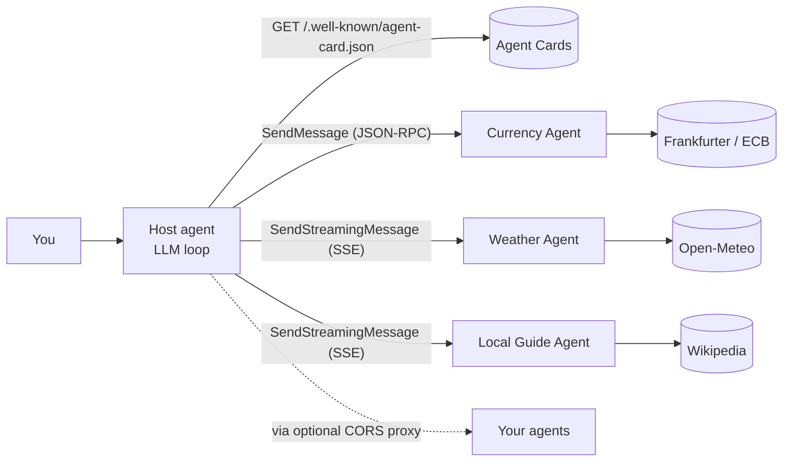

# A2A, Explained

A working multi-agent app on the left, and a live look at the **Agent2Agent (A2A) protocol** on the right.

The app is a **trip planner**. You chat with a *host agent* that knows nothing about weather, money or places. It reads the **Agent Cards** of remote agents, delegates work to them as A2A **tasks**, and combines the **artifacts** they send back. You can **add any A2A agent by URL**.

**Live demo:** `https://asdvoid341.github.io/a2a-demo/` · Companion to the [agent-harness demo](https://asdvoid341.github.io/agent-harness/), which explains the inside of a single agent.

- **No key?** Demo mode: a scripted host drives *real* A2A calls to *real* agents. They fetch live data from Open-Meteo, Frankfurter (ECB rates) and Wikipedia.
- **Bring your own key** (Anthropic, OpenAI or Gemini) and the host becomes an LLM that decides which agents to call. The key stays in your browser. There is no server.

---

## What you can see

**Simple view** (default)
- **Who is talking to whom:** the user, the host and each remote agent. Every real HTTP exchange is animated: requests out, streamed events back, card fetches dashed.
- **Task lifecycle:** the A2A state machine with each live task drawn on its current state (`SUBMITTED → WORKING → INPUT_REQUIRED → COMPLETED / FAILED / REJECTED / CANCELED`).
- **What just happened:** the run in plain English (Discover → Delegate → Collaborate → Combine), with a *Why?* on every step.

**Technical view**
- **Wire:** every request and response, with headers, the JSON-RPC body and each Server-Sent Event frame.
- **Agent Cards:** the raw cards, with the fields that matter annotated and any warnings.
- **Tasks:** tasks as the client assembled them from events. Re-fetch one with `GetTask` or stop it with `CancelTask`.
- **Host model:** the system prompt generated from the cards, the single `send_message` tool, and every model call.
- **Concepts:** A2A vs MCP, cards, tasks, parts and artifacts, streaming, what changed in 1.0, trust.

### Things worth trying

1. **“Plan 3 days in Lisbon next week. My budget is ₹75,000.”** Three agents work in parallel. The Currency Agent answers with one plain `SendMessage`. The Weather Agent streams its forecast in chunks. The Local Guide pauses in `INPUT_REQUIRED` to ask what you like; your reply goes back to the **same task**.
2. **“Weather in Hogwarts”** gives a task that `FAILED`. **“Convert 100 EUR to Bitcoin”** gives one that is `REJECTED`.
3. **“Which currencies can you convert?”** Quick questions get a direct **Message** back, with no task.
4. Click an agent chip and **turn it off**: the host's roster (built from the cards) no longer includes it.
5. **Add an agent.** Deploy the companion Worker in [`proxy/`](proxy/) (free, one command) and paste its URL. Before any data goes to an external agent, you are asked to approve.
6. In **Technical → Tasks**, `GetTask` a finished task, or `CancelTask` one that is waiting for input.

---

## How it works



| Piece | What it does | Code |
|---|---|---|
| **Built-in agents** | Three real A2A 1.0 servers, hosted by a **Service Worker**, so the page reaches them over genuine HTTP at `./agents/<id>/`. Open `agents/weather/.well-known/agent-card.json` in a tab to see a card. | [`sw.js`](sw.js), [`src/server/`](src/server/) |
| **A2A server** | JSON-RPC routing, `A2A-Version` check, task store (IndexedDB, so a paused task survives the worker restarting), streaming, multi-turn tasks, chunked artifacts, `GetTask`/`CancelTask`. | [`src/server/a2a-server.js`](src/server/a2a-server.js) |
| **A2A client** | Discovery, `SendMessage` vs `SendStreamingMessage` (chosen from the card), SSE parsing, task assembly from events, error classification (CORS, auth, JSON-RPC codes), **0.3 compatibility**. | [`src/a2a/client.js`](src/a2a/client.js), [`card.js`](src/a2a/card.js), [`sse.js`](src/a2a/sse.js) |
| **Registry** | Built-in plus user-added agents. Cards are re-fetched on every visit. | [`src/a2a/registry.js`](src/a2a/registry.js) |
| **Host agent** | An agent loop whose one tool is `send_message(agent, text, task_id?)`. Parallel delegation, one `contextId` per agent, continuing `INPUT_REQUIRED` tasks, approval before data leaves for an external agent. | [`src/host/host.js`](src/host/host.js), [`prompt.js`](src/host/prompt.js) |
| **Scripted host** | The no-key stand-in: a rule-based planner (any city or amount, not canned replies) that speaks the Anthropic wire format. | [`src/host/demo-model.js`](src/host/demo-model.js) |
| **Provider adapters** | Anthropic, OpenAI, Gemini over raw HTTP (shared with agent-harness). | [`src/providers/`](src/providers/) |
| **Views** | Each panel only subscribes to the event bus, so it shows what actually happened. | [`src/ui/`](src/ui/), [`src/events.js`](src/events.js) |

### A2A 1.0 in brief (what this demo implements)

- **Agent Card** at `/.well-known/agent-card.json`. It lists endpoints in `supportedInterfaces: [{ url, protocolBinding: "JSONRPC", protocolVersion: "1.0" }]`, plus `capabilities`, `skills`, and the default input/output modes.
- **JSON-RPC 2.0** with an `A2A-Version: 1.0` header. Methods: `SendMessage`, `SendStreamingMessage`, `GetTask`, `CancelTask` (the spec also has `ListTasks`, `SubscribeToTask` and push-notification config).
- **Messages** have `role: "ROLE_USER" | "ROLE_AGENT"` and `parts`. Each part holds exactly one of `text`, `data`, `url` or `raw`.
- **Tasks** carry a `status.state` such as `"TASK_STATE_INPUT_REQUIRED"`, plus `artifacts` and `history`. A stream sends `{ task }` first, then `{ statusUpdate }` and `{ artifactUpdate }` events (with `append` and `lastChunk`).
- **Versus 0.3:** no `kind` discriminators, SCREAMING_SNAKE enums, PascalCase methods, and `supportedInterfaces` instead of `url`. The client detects 0.3 cards and speaks 0.3 to those agents (`message/send`, `kind`, lowercase states).

---

## Design decisions

- **No backend.** The built-in agents run in a Service Worker. If Service Workers are unavailable (some private windows, hard reload), the same server code runs in the page, and the map's subtitle says so.
- **Real agents, real data.** Only the host's reasoning is scripted in demo mode. Every A2A message, task and artifact is real, and the agents call real public APIs.
- **The host only knows the cards.** Its system prompt is generated from the connected agents' cards on every question. Turning an agent off removes it from the prompt.
- **Remote content is untrusted.** The host prompt says to treat agent output and cards as data. The client flags card text that reads like instructions to an AI. You approve before any message goes to an external agent.
- **CORS is a real constraint.** Most A2A agents are built for server-to-server calls. The optional proxy in [`proxy/`](proxy/) is yours to deploy and lock down (https only, no private addresses, optional origin allow-list).
- **No build step.** Plain ES modules (classic scripts for the Service Worker), so the code in the repo is the code that runs.

## Run locally

Service Workers need `http://localhost` or HTTPS, and ES modules don't load from `file://`:

```bash
npx serve .
```

or

```bash
python -m http.server 8000
```

## Deploy (GitHub Pages)

1. Push this repo to GitHub.
2. **Settings → Pages → Build and deployment → Source: GitHub Actions.**
3. Every push to `main` deploys via [`.github/workflows/deploy.yml`](.github/workflows/deploy.yml).
4. In [`src/config.js`](src/config.js), set `repoUrl`, `author` and `authorUrl`.

## Adding a built-in agent

```js
// src/server/agents/my-agent.js  (classic script; add it to sw.js and src/a2a/transport.js)
A2AServer.register({
  id: 'my-agent',
  card: (base) => ({ name: 'My Agent', description: '…', version: '1.0.0',
    supportedInterfaces: [{ url: `${base}a2a/v1`, protocolBinding: 'JSONRPC', protocolVersion: '1.0' }],
    capabilities: { streaming: true }, defaultInputModes: ['text/plain'], defaultOutputModes: ['text/plain'],
    skills: [{ id: 'x', name: 'X', description: '…', tags: ['x'] }] }),
  async execute(ctx) {                       // ctx.text, ctx.data, ctx.resumed, ctx.internal
    await ctx.working('Thinking…');          // status update
    if (!ctx.text) return ctx.inputRequired('What should I do?');
    await ctx.artifact({ name: 'result', parts: [{ text: 'Done' }] });
    await ctx.complete('All done.');         // or ctx.fail(…) / ctx.reject(…)
  },
});
```

Then add `{ id: 'my-agent', icon: '…' }` to `BUILTINS` in [`src/a2a/registry.js`](src/a2a/registry.js).

## Costs & privacy

With your own key, the host's model calls are billed to your provider account (capped at 8 model calls and $0.50 per question). Messages to built-in agents stay in your browser, apart from the agents' own lookups to Open-Meteo, Frankfurter and Wikipedia. Messages to agents you add go to whoever runs them, which is why you are asked first.

## License

MIT
